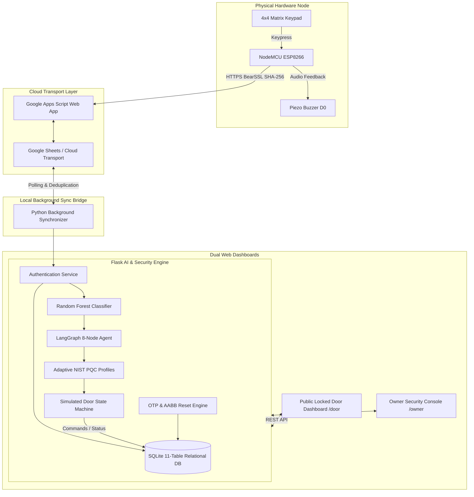

# Agentic AI-Driven Adaptive Post-Quantum Smart Door Lock
> **Major Project Final Build** • Enterprise-Grade Autonomous IoT Security System with NIST Quantum-Resistant Cryptography, 8-Node LangGraph Agent, Random Forest Risk Classification, Dual Web Dashboards, and NodeMCU ESP8266 Hardware Integration.

---

## 📑 Table of Contents
1. [Executive Summary](#-executive-summary)
2. [End-to-End Architecture](#-end-to-end-architecture)
3. [Dual Dashboard Interface](#-dual-dashboard-interface)
4. [Hardware Node Configuration](#-hardware-node-configuration)
5. [Core AI & Cryptographic Subsystems](#-core-ai--cryptographic-subsystems)
   - [Random Forest Risk Classification](#1-random-forest-risk-classifier)
   - [LangGraph 8-Node Autonomous Security Agent](#2-langgraph-8-node-autonomous-agent)
   - [NIST Post-Quantum Cryptography Suite](#3-adaptive-nist-pqc-profiles)
   - [Cryptographic OTP & AABB Password Reset Engine](#4-cryptographic-otp--aabb-password-reset-engine)
6. [SQLite Relational Database Schema](#-sqlite-relational-database-schema)
7. [Installation & Setup Guide](#-installation--setup-guide)
8. [Running the Application](#-running-the-application)
9. [Automated Verification & Test Suite](#-automated-verification--test-suite)
10. [College Viva Voce Defense & Examiner Q&A](#-college-viva-voce-defense--examiner-qa)

---

## 🌟 Executive Summary

Traditional IoT access control systems rely on static cryptographic protocols (RSA/ECC) and deterministic rule-based authorization logic, rendering them vulnerable to:
1. **Quantum Computing Adversaries:** Harvest-Now-Decrypt-Later (HNDL) attacks breaking discrete logarithm and integer factorization schemes.
2. **Dynamic Attack Vectors:** Distributed brute-force attacks, timing analysis, and attempt bursts bypassing naive rate-limiting.
3. **Insecure Password Recovery:** Cloud-dependent insecure reset links prone to interception and replay.

This project delivers an **Autonomous, Quantum-Resistant, Adaptive Access Control Infrastructure**:
- **Dual Operating Surfaces:** Public simulated 3D door (`/door`) and an Authenticated Owner Security Operations Center (`/owner`).
- **NIST Post-Quantum Cryptography:** Dynamically scaled lattice-based algorithms (**ML-KEM** / FIPS 203 and **ML-DSA** / FIPS 204) across NIST Security Levels 1, 3, and 5.
- **Agentic AI Orchestration:** 8-node stateful **LangGraph** agent executing an autonomous `observe -> assess -> reassess -> plan -> decide -> act -> recommend -> reflect` cognitive loop.
- **Machine Learning Threat Detection:** 250-tree **Random Forest Classifier** trained on high-dimensional access telemetry (93.58% accuracy).
- **Physical Keypad Password Reset Flow:** `AABB` sequence detection on hardware with 2-minute cryptographic single-use OTP validation.
- **Relational Source of Truth:** Multi-table **SQLite** database operating with WAL mode, PBKDF2-HMAC-SHA256 password hashing, and zero plaintext secret leakage.

---

## 🏛️ End-to-End Architecture



---

## 🖥️ Dual Dashboard Interface

### 1. Public Locked Door Dashboard (`http://127.0.0.1:5000/door` or `/`)
- **3D Simulated Door Visualizer:** Interactive perspective-transformed door leaf with dynamic locking bolt and status illumination.
- **Access Control Terminal:** Virtual 4x4 matrix keypad supporting mouse, touch, and physical keyboard inputs.
- **Real-Time AI Pipeline Flow:** Dynamic node-by-node illumination of the 8 LangGraph stages during live authentication.
- **Live Agent Reasoning Stream:** Human-readable explanations of security evaluations, risk probabilities, and active PQC suites.
- **Hardware Telemetry Indicator:** Live online/offline status badge of the NodeMCU ESP8266 hardware node.

### 2. Owner Security Operations Console (`http://127.0.0.1:5000/owner`)
- **Authentication Barrier:** Protected by PBKDF2-salted administrative credentials (`admin` / `admin123`) with 24-hour cryptographic session tokens.
- **Direct Actuator Override:** Instant remote manual lock and unlock controls for the simulated door.
- **Password Management & OTP Module:** Live 6-digit cryptographic reset OTP generator with 120-second active countdown timer and revocation controls.
- **Intrusion Risk Analytics:** Real-time risk distribution bar charts (LOW, MEDIUM, HIGH) and attempt velocity telemetry.
- **NIST PQC Suite Inspector:** Live profile comparator displaying active key encapsulation (ML-KEM) and digital signature (ML-DSA) algorithms.
- **Immutable Security Audit Log:** Tabular log of all access events, timestamps, source identifiers, truncated SHA-256 digests, decisions, and system alerts.

---

## 🔌 Hardware Node Configuration

### Microcontroller: NodeMCU ESP8266 (ESP-12E Module)
The door is strictly simulated in the web browser. The physical hardware consists of the NodeMCU microcontroller, 4x4 matrix keypad, and buzzer.

| Component | Pin Label | NodeMCU GPIO | Function / Mode |
| :--- | :--- | :--- | :--- |
| **Keypad Row 1** | `R1` | `GPIO 5` (`D1`) | Row Output Scanning |
| **Keypad Row 2** | `R2` | `GPIO 4` (`D2`) | Row Output Scanning |
| **Keypad Row 3** | `R3` | `GPIO 14` (`D5`) | Row Output Scanning |
| **Keypad Row 4** | `R4` | `GPIO 12` (`D6`) | Row Output Scanning |
| **Keypad Col 1** | `C1` | `GPIO 13` (`D7`) | Column Input (Pullup) |
| **Keypad Col 2** | `C2` | `GPIO 0` (`D3`) | Column Input (Pullup) |
| **Keypad Col 3** | `C3` | `GPIO 2` (`D4`) | Column Input (Pullup) |
| **Keypad Col 4** | `C4` | `GPIO 15` (`D8`) | Column Input (Pullup) |
| **Piezo Buzzer** | `+` | `GPIO 16` (`D0`) | Audio Tone Feedback |
| **Piezo Buzzer** | `-` | `GND` | Ground |

### Buzzer Acoustic Frequency Patterns:
- **Keypress:** Short chirp (40ms).
- **Authorized / Success:** Ascending double-tone (100ms on, 80ms off, 120ms on).
- **Access Denied:** Descending triple-tone (120ms on, 80ms off × 3).
- **High-Risk Lockout Alarm:** Continuous pulsed siren pattern (300ms on, 100ms off × 4).
- **Password Reset Mode Activated:** Dual warning tone (200ms on, 100ms off × 2).

---

## 🧠 Core AI & Cryptographic Subsystems

### 1. Random Forest Risk Classifier
The machine learning subsystem utilizes an ensemble of **250 randomized decision trees** trained on synthetic multidimensional access vectors:
- **Features Analyzed:** `failed_auth_attempts`, `successful_auth_attempts`, `attempt_velocity` (attempts / 30s), `communication_latency_ms`, `cpu_utilization`, `memory_usage`, `network_anomaly`, `threat_indicator`.
- **Classification Output:** Multi-class probabilities mapping to `LOW`, `MEDIUM`, or `HIGH` risk tiers.
- **Model Accuracy:** 93.58% test accuracy, evaluated with 5-fold stratified cross-validation.

### 2. LangGraph 8-Node Autonomous Agent
The cognitive decision engine implements an 8-node directed acyclic state graph executing sequentially:

```
[1. OBSERVE] ➔ Telemetry ingestion & sliding window velocity analysis
     ↓
[2. ASSESS] ➔ Random Forest ML inference & class probability calculation
     ↓
[3. REASSESS] ➔ Threat indicator evaluation & progressive escalation rules
     ↓
[4. PLAN] ➔ PQC algorithm selection & defensive posture formulation
     ↓
[5. DECIDE] ➔ Binary access determination (ALLOW / DENY / LOCKOUT)
     ↓
[6. ACT] ➔ PQC key generation, simulated door actuation, command queueing
     ↓
[7. RECOMMEND] ➔ Automated administrative advisories & mitigation directives
     ↓
[8. REFLECT] ➔ Agent introspection, ML vs Agent agreement metrics, SQLite audit commit
```

### 3. Adaptive NIST PQC Profiles
In compliance with NIST Post-Quantum Cryptography Standardization (August 2024), the system dynamically scales cryptographic strength:

| Risk Tier | Security Profile | NIST Standard | Key Encapsulation (KEM) | Digital Signature (DSA) | Target Threat Scenario |
| :--- | :--- | :--- | :--- | :--- | :--- |
| **LOW** | Profile 1 | NIST Level 1 (AES-128 equivalent) | **ML-KEM-512** | **ML-DSA-44** | Normal verified owner access |
| **MEDIUM** | Profile 2 | NIST Level 3 (AES-192 equivalent) | **ML-KEM-768** | **ML-DSA-65** | Anomalous timing / isolated failure |
| **HIGH** | Profile 3 | NIST Level 5 (AES-256 equivalent) | **ML-KEM-1024** | **ML-DSA-87** | Brute-force burst / Intrusion lockout |

### 4. Cryptographic OTP & AABB Password Reset Engine
To prevent unauthorized hardware credential modification:
1. **Sequence Trigger:** Keypad inputs `AABB` -> triggers `STATE_RESET_WAITING_OTP`.
2. **OTP Generation:** Owner accesses `/owner` -> clicks `GENERATE RESET OTP` -> system generates a 6-digit random code (`secrets.randbelow`) valid for exactly **120 seconds**. The OTP hash is committed to SQLite.
3. **Keypad Verification:** User enters 6-digit OTP on physical keypad or terminal -> verified against salted PBKDF2 hash. Maximum 3 incorrect attempts before session revocation.
4. **Atomic Password Update:** User enters and confirms new PIN (4-8 digits) -> password table version is incremented, old PIN is marked inactive, new PIN is active immediately.

---

## 🗄️ SQLite Relational Database Schema

The database (`backend/data/smart_door.db`) maintains 11 normalized relational tables:
1. `owners`: Administrative accounts (`username`, `password_hash`, `salt`, `status`).
2. `owner_sessions`: Cryptographic 24h bearer tokens (`session_token`, `owner_id`, `expires_at`).
3. `door_credentials`: Door PIN credentials with versioning (`credential_name`, `pin_hash`, `salt`, `version`, `is_active`, `user_alias`).
4. `devices`: Hardware telemetry and registration records (`device_id`, `ip_address`, `rssi`, `wifi_status`, `device_state`, `is_online`).
5. `authentication_events`: Access history (`source`, `attempted_hash`, `user`, `result`, `ml_risk`, `agent_risk`, `pqc_kem`, `action_taken`).
6. `security_events`: High-level alerts and subsystem telemetry (`severity`, `event_type`, `description`, `metadata_json`).
7. `risk_assessments`: ML and agent risk outputs (`ml_predicted_risk`, `agent_final_risk`, `attempt_velocity`).
8. `agent_decisions`: Comprehensive LangGraph execution traces (`reasoning_json`, `plan_json`, `recommendations_json`).
9. `commands`: Replay-protected command queue for hardware actuation (`command`, `risk_level`, `status`, `expires_at`).
10. `reset_sessions`: Multi-step password reset sessions (`session_id`, `otp_hash`, `salt`, `status`, `attempt_count`, `expires_at`).
11. `system_config`: Central key-value runtime configuration store (`config_key`, `config_val`).

---

## 🚀 Installation & Setup Guide

### Prerequisites
- Python 3.11+
- Arduino IDE (for NodeMCU ESP8266 firmware flashing)
- Modern Web Browser (Chrome / Edge / Firefox)

### Step 1: Install Python Dependencies
```bash
cd backend
py -3.11 -m pip install -r requirements.txt
```

### Step 2: Train Machine Learning Risk Model
```bash
cd backend
py -3.11 ml/train_model.py
```
*Output: Generates synthetic training dataset and exports trained model to `backend/models/risk_classifier.pkl`.*

### Step 3: Flash NodeMCU ESP8266 Firmware (Optional for Hardware Node)
1. Open Arduino IDE.
2. Install `esp8266` board support via Board Manager (`Tools > Board > Boards Manager > esp8266`).
3. Install `Keypad` library via Library Manager (`Sketch > Include Library > Manage Libraries... > Keypad`).
4. Open `esp8266/smart_door_esp8266/smart_door_esp8266.ino`.
5. Verify Wi-Fi credentials in `esp8266/secrets.h` (SSID: `KALI`, Password: `12345678`).
6. Select Board: `NodeMCU 1.0 (ESP-12E Module)`, Port: COM port of ESP8266.
7. Click **Upload**.

---

## 🏃 Running the Application

### 1. Start the Flask Backend Server
```bash
cd backend
py -3.11 app.py
```
*The server starts on `http://127.0.0.1:5000`.*

### 2. Start the Google Sheets Background Synchronizer
```bash
cd backend
py -3.11 sync_google_sheets.py --interval 3
```

### 3. Access the Dashboards
- **Public Locked Door Dashboard:** Open [http://127.0.0.1:5000/door](http://127.0.0.1:5000/door)
- **Owner Security Console:** Open [http://127.0.0.1:5000/owner](http://127.0.0.1:5000/owner) (Default login: `admin` / `admin123`)

---

## 🧪 Automated Verification & Test Suite

The system includes a master automated test suite verifying all 46 functional and security criteria:

```bash
cd backend
py -3.11 -m unittest discover -s tests -p "test_*.py" -v
```

### Test Coverage Summary:
- **`test_master_suite.py` (27 Tests):** Owner Auth, Door Credential Verification, PBKDF2 Hashing, Attempt Velocity, Security Lockout, 6-Digit OTP Engine, AABB Reset Sequence, 8-Node LangGraph Cycle, Adaptive PQC Profiles, Command Lifecycle, Secret Redaction.
- **`test_api_endpoints.py` (8 Tests):** Dual Dashboard HTTP routes (`/door`, `/owner`), Health check, Authentication pipeline, Session cookies, Protected analytics endpoints, Password reset REST endpoints.
- **`test_hardware_pipeline.py` (11 Tests):** Hardware SHA-256 matching, Google Sheets transport idempotency, Duplicate filtering, Telemetry status persistence, PQC profile selection.

---

## 🎓 College Viva Voce Defense & Examiner Q&A

### Q1: Why is Post-Quantum Cryptography needed for an IoT smart door lock?
> **Answer:** Standard public-key cryptography (RSA and ECC) depends on mathematical problems like integer factorization and discrete logarithms, which can be solved in polynomial time by Shor's Algorithm on a fault-tolerant quantum computer. Adversaries are currently executing "Harvest-Now-Decrypt-Later" (HNDL) attacks—intercepting and storing encrypted IoT communications today to decrypt them once quantum hardware matures. Our system implements NIST FIPS 203 (ML-KEM) and FIPS 204 (ML-DSA) lattice-based cryptography to guarantee long-term forward secrecy against both classical and quantum adversaries.

### Q2: Why is the AI split into a Random Forest Classifier AND a LangGraph Agent?
> **Answer:** The two AI systems serve distinct complementary roles:
> 1. **Random Forest Classifier (Statistical Perception):** Performs ultra-fast, microsecond-level statistical inference on continuous telemetry vectors (failed attempt streaks, velocity, system metrics) to output calibrated risk probabilities.
> 2. **LangGraph Agent (Cognitive Orchestration):** Executes a deterministic 8-node state machine that contextualizes the ML output, evaluates progressive escalation rules, determines the exact PQC profile, triggers autonomous physical actions (lockout, alert, unlock), and performs self-reflective reasoning. This separation gives us both high-speed perception and explainable, auditable autonomous decision-making.

### Q3: How does the password reset flow prevent unauthorized physical resets?
> **Answer:** Traditional IoT reset buttons or hardcoded sequences are vulnerable to anyone with physical access. Our system implements a 2-factor physical-digital protocol:
> 1. The user keys `AABB` on the physical keypad to place the lock in reset mode.
> 2. The lock *cannot* be reset without a 6-digit cryptographic OTP generated by the authenticated owner in `/owner`.
> 3. The OTP is time-bounded (120 seconds TTL), single-use, rate-limited (max 3 tries), and verified against a salted PBKDF2 hash.

### Q4: How is security maintained across Google Sheets and the ESP8266?
> **Answer:** 
> 1. **Zero Plaintext Secrets:** The ESP8266 calculates BearSSL SHA-256 hashes locally on the microcontroller before transmitting over Wi-Fi. Plaintext PINs never traverse the network or appear in Google Sheets.
> 2. **Transport Layer Only:** Google Sheets acts purely as an asynchronous message queue, not the security authority. The Python backend is the sole source of truth and performs all authentication against SQLite.
> 3. **Idempotency & Replay Protection:** Every event has a unique cryptographic `event_id` and timestamp; duplicates are rejected by the synchronizer.

---
**Major Project Build Verified and Complete.**
